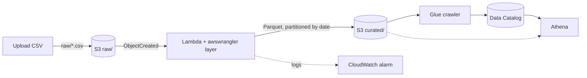
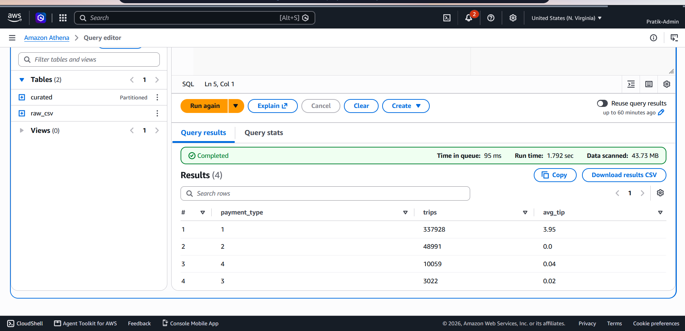
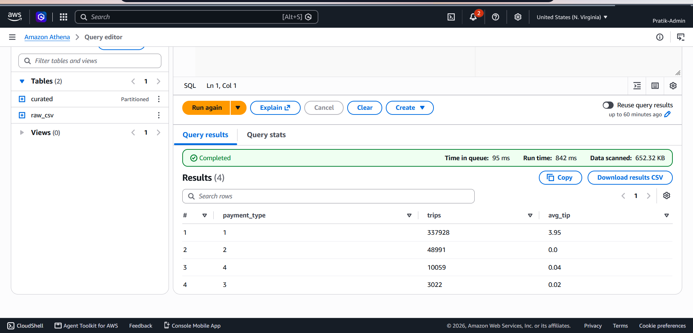

# ParquetFlow

A small serverless data pipeline on AWS: upload a CSV, and it is cleaned and converted to partitioned Parquet, then queryable in Athena. I built every resource with the AWS CLI to learn how each piece fits together, then rebuilt the same pipeline as a SAM template.

> The AWS resources have been deleted to avoid ongoing cost. The results below were captured while it was running. To run it again, deploy [template.yaml](template.yaml) with SAM (see [Deploy with SAM](#deploy-with-sam-infrastructure-as-code)).



## Result

Same question, same answer, on the same 400,000 NYC yellow taxi trips (Feb 2025):

| Table | Data scanned | |
|---|---|---|
| CSV (`raw_csv`) | 43.73 MB | baseline |
| Parquet (`curated`) | 0.64 MB | ~69× less |
| Parquet, one date only | 0.13 MB | ~324× less |

The CSV is 43.7 MB and the Parquet output is about 8 MB. More in [docs/scan-comparison.md](docs/scan-comparison.md).

| CSV: 43.73 MB scanned | Parquet: 652 KB scanned |
|---|---|
|  |  |

## How it works

1. **S3** holds `raw/` (input) and `curated/` (output) in one bucket with public access blocked.
2. **Lambda** (Python 3.12, AWS-managed *AWS SDK for pandas* layer, so nothing to package) runs on `ObjectCreated` for `raw/*.csv`. It normalises column names, parses datetimes to millisecond timestamps, drops rows with a missing or invalid date, removes duplicates, and writes Parquet partitioned by `date`.
3. **Glue crawler** reads `curated/` and registers the table and partitions in the Data Catalog.
4. **Athena** queries the catalog. A second table over `raw/` lets the same query run on the CSV.
5. **CloudWatch** keeps the Lambda logs and has an alarm on the `Errors` metric.

## Key CLI commands

| Step | Commands |
|---|---|
| Identity | `aws sts get-caller-identity` |
| Bucket | `s3api create-bucket`, `put-public-access-block`, `put-object` |
| IAM | `iam create-role`, `put-role-policy`, `attach-role-policy`, `simulate-principal-policy` |
| Lambda | `lambda create-function`, `update-function-code`, `invoke`, `add-permission` |
| Trigger | `s3api put-bucket-notification-configuration` |
| Logs | `logs tail`, `logs filter-log-events` |
| Catalog | `glue create-database`, `create-crawler`, `start-crawler`, `get-table` |
| Query | `athena create-work-group`, `start-query-execution`, `get-query-execution`, `get-query-results` |
| Alarm | `cloudwatch put-metric-alarm` |

Scripts are in [scripts/](scripts/), policies in [infra/](infra/), queries in [sql/](sql/).

## Deploy with SAM (infrastructure as code)

[template.yaml](template.yaml) describes the whole pipeline: bucket, Lambda and its trigger, Glue database and crawler, Athena workgroup and the error alarm. It uses `parquetflow-sam-*` names, so it can run next to the hand-built version.

```powershell
sam build
sam deploy --stack-name parquetflow-sam --region us-east-1 --capabilities CAPABILITY_IAM --resolve-s3
```

Verified end to end: uploading the sample CSV produced the same six partitions, the same query result, and exactly the same bytes scanned (667,977) as the CLI-built stack.

What SAM does for you compared with the CLI steps:
- The `Events:` block on the function creates both the Lambda invoke permission and the bucket notification, two separate calls when done by hand.
- CloudFormation works out the creation order, so the bucket, role, function and trigger need no manual sequencing.
- One difference: SAM attaches the managed `AWSLambdaBasicExecutionRole` to the function role, which is broader for logging than the hand-written policy scoped to `parquetflow-*` log groups.

To try the Lambda with a local event, copy `tests/event.json` to `tests/event.local.json` (git-ignored) and replace `REPLACE_ME` with your bucket name.

## Security

- The Lambda role reads only `raw/*` and writes only `curated/*`. `simulate-principal-policy` confirms `PutObject` is `implicitDeny` on `raw/` and `allowed` on `curated/`.
- The Glue role has the AWS-managed service policy plus read access to `curated/*` only.
- S3 invokes the function through a resource policy scoped to this bucket and this account.

## Design decisions and limits

- **Lambda, not a Glue job.** Cheapest option for files of tens of MB. The test file used about 650 MB of the 1024 MB configured, roughly 15× the file size, and ran in about 11 seconds. The full 380 MB source file would need around 5–6 GB by that ratio. Beyond that, read in chunks or move to a Glue or EMR job.
- **Partition by day.** The query pattern is by date, and the sample covers only 6 days. For years of data this would be too fine, and monthly partitions would be better.
- **`overwrite_partitions`.** Re-uploading the same file is safe and gives identical results. The catch: a different file containing dates already present replaces those dates. Merging files into the same dates would need `append` plus deduplication.
- **Millisecond timestamps.** pandas writes nanoseconds by default, which Athena does not handle well, so datetimes are cast to milliseconds before writing.
- **Date column is configurable** through the `DATE_COLUMN` environment variable, so the function is not tied to taxi data.
- **Not production-grade.** No retries or dead-letter queue, no orchestration, no data-quality checks beyond date and duplicate handling, and the Athena minimum charge of 10 MB per query makes every query cost the same at this size.

## Cost

A few cents at most with this dataset. Crawler runs are billed per minute, and Athena has a 10 MB minimum per query.

## Cleanup

For the SAM stack, empty the bucket first because CloudFormation cannot delete a non-empty bucket, then delete the stack:

```powershell
aws s3 rm s3://parquetflow-sam-<account>-<region> --recursive
sam delete --stack-name parquetflow-sam
```

For the CLI-built version, delete the S3 objects and bucket, the Lambda, the Glue crawler and database, the Athena workgroup, the alarm and both IAM roles. Remove each role's policies before deleting the role.
